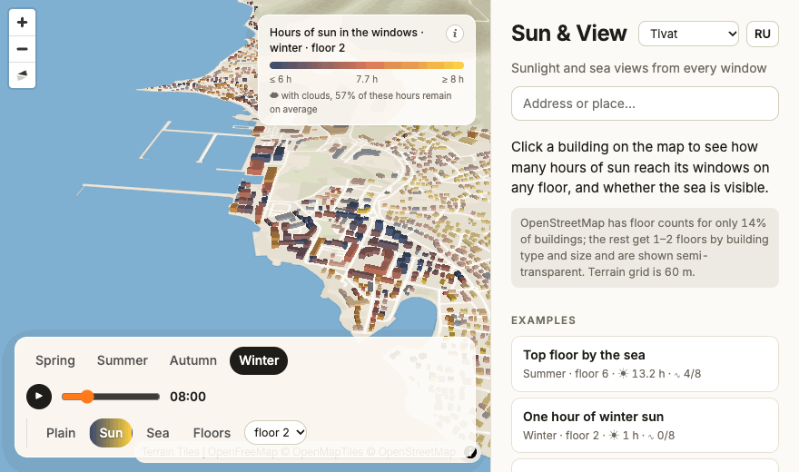
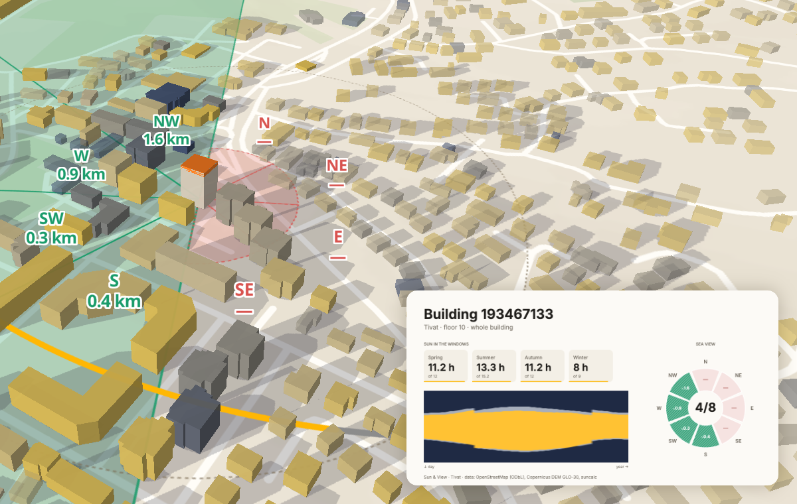

# Sun & View

[](https://github.com/yetit/sun-view/actions/workflows/deploy.yml)
[](https://github.com/yetit/sun-view/actions/workflows/live.yml)
[](tests/)
[English](README.md)



**Кликните здание, выберите этаж — и увидите, сколько часов прямого солнца попадает в окна в каждый сезон и в каких направлениях видно море. Всё считается в браузере по открытым данным.**

**Демо: [yetit.github.io/sun-view](https://yetit.github.io/sun-view/?lang=ru)** · Тиват и Котор (Черногория), Берген (Норвегия) · русский и английский (`?lang=ru|en`)

## Что умеет

- **Солнце в окнах.** Часы прямого солнца в весеннее и осеннее равноденствия, летнее и зимнее солнцестояния, плюс лента года (день × час). Можно выбрать здание целиком или одну сторону, от С до СЗ.
- **Вид на море.** По 8 направлениям: видна ли вода с уровня окна и как до неё далеко.
- **Карты города.** На входе весь город окрашен по зимнему солнцу. Можно переключиться на карту моря и выбрать высоту окна: 2, 5 или 10 м над землёй. Цвета следуют реальному разбросу часов в текущем слое, легенда их показывает. Дома ниже выбранной высоты блёклые и показаны с верхнего этажа.
- **Ползунок времени.** Освещение домов, тени на земле и положение солнца следуют за временем суток, ▶ прокручивает сутки.
- **Надёжность.** У каждого здания метка: высокая, средняя или низкая, с причинами — этажность оценена, крутой склон, рядом лес.
- **Сравнение и PNG.** До четырёх квартир можно поставить рядом, скачать карточку или отправить ссылку. Ссылка хранит город, здание, этаж, сторону, сезон и время.
- **Клавиатура.** Перейдите на карту клавишей Tab. Enter выбирает здание в центре, стрелки — ближайшее здание в эту сторону экрана, Esc снимает выбор. Выбор и сводка объявляются скринридеру.
- **Встраивание.** Добавьте `embed=1` к любой ссылке — останутся карта, здание и компактная панель для `<iframe>`. Высоту iframe можно подгонять через `postMessage`. Готовый код — на [странице встраивания](https://yetit.github.io/sun-view/embed/?lang=ru) и ниже.

## Города

| Город | Чем интересен | Зданий | Этажность в OSM |
| --- | --- | --- | --- |
| Тиват | Город в бухте на Адриатике, рельеф с северо-востока | 3 625 | 14 % |
| Котор | Старый город у подножия крутой горы, узкий залив | 3 654 | 3 % |
| Берген | 60° с. ш.: в декабре солнце в полдень поднимается всего на ~6°, центр зажат между фьордом и «семью горами» | 5 030 | 58 % |

**Почему Берген.** Третий город нужен был с другой широтой и рельефом и с приличной этажностью. Я сравнил Тромсё, Берген, Тронхейм, Олесунн, Будё, Инсбрук и Лугано. У Бергена лучшее покрытие этажности: 54–58 % зданий центра. Там есть и море, так что вид на воду остаётся осмысленным. У Инсбрука покрытие похожее, но моря нет. Тромсё севернее, но этажность там только у 34 % зданий. Адресов на зданиях Бергена в OSM нет: в Норвегии их наносят отдельными точками. Поэтому здания подписаны ближайшей улицей.



## Как считается

1. **Мир в метрах.** Контуры из OpenStreetMap превращаются в растр крыш с шагом 6 м: абсолютная отметка каждой кровли и кроны. Copernicus DEM GLO-30 превращается в сетку рельефа 60 м примерно на 15 км вокруг города.
2. **Лучи в браузере.** Каждые 10 минут суток положение солнца берётся из [suncalc](https://github.com/mourner/suncalc). Луч из окна идёт шагом 3 м до 1 км и проверяет крыши, деревья и рельеф, дальше шагом 30 м до 15 км и проверяет только рельеф. Упёрся — тень.
3. **Вид на море** считается тем же маршем. Луч держит максимальный угол места препятствий, и ячейка моря видна, если её угол выше всех препятствий до неё.
4. **Воркер и предрасчёт.** Карты солнца и моря для всего города — это 15 слоёв на город, 54 КБ. Их строит `scripts/precompute.ts` при выгрузке данных, поэтому карта красится сразу. Без них, а также для ленты года, считает Web Worker в фоне. Результат кэшируется по слою.

Код: `src/scripts/grid.ts` (растры, лучи), `analysis.ts` (сезоны, роза моря, карты города), `worker.ts`, `map/` (слои MapLibre, тени), `ui/` (панель, таймбар, мобильный лист). Подробнее и с картинками — на странице [«Как считается»](https://yetit.github.io/sun-view/method?lang=ru).

## Проверка

Горизонт по рельефу сверен с [PVGIS](https://re.jrc.ec.europa.eu/pvg_tools/en/) (Еврокомиссия, JRC). Проверка шла в 16 точках Тивата и Котора, по 48 азимутов в каждой. Севернее 60° с. ш. рельеф у PVGIS оказался с ячейкой 30″ (~0,9 × 0,5 км), а не 3″: верхняя станция фуникулёра на Флёйен в Бергене (320 м) у него на 140 м. Поэтому 8 точек Бергена сверены с горизонтом по лидарной модели земли 1 м норвежского Картверкета ([DTM](https://hoydedata.no)). Полный отчёт: [docs/horizon-check.md](docs/horizon-check.md).

| Где | Среднее расхождение горизонта | Восход 21 декабря |
| --- | --- | --- |
| Ровные места у моря, Тиват | 0,2° | та же минута, что у PVGIS (±1) |
| Все 8 точек, Тиват | 1,5° (было 2,1°) | — |
| Все 8 точек, Котор | 1,3° (было 1,7°) | — |
| Крутой склон Врмаца | 5,5° (было 8,3°) | на 99 мин позже PVGIS; закат совпал (было на 39 мин раньше) |
| 7 точек на склонах против исходного Copernicus 1″ | 0,4° (было 2,2°) | — |
| Все 8 точек Бергена против DTM Картверкета | 0,8° (было 1,0°) | — |
| Ровные места Бергена: Брюгген, Фестплассен, подножие Ульрикена | 0,3–0,4° | до минуты у Брюггена и Фестплассена, на 8 мин раньше у Ульрикена |
| Берген против PVGIS, для справки | 5,0° | расходится на час-два: грубый рельеф PVGIS |

Высота рельефа интерполируется билинейно — и в точке наблюдения, и вдоль луча. Раньше бралась ближайшая ячейка 60 м: на склоне глаз оказывался на 20–30 м ниже поверхности, которую видит луч, и склон казался круче. Остаток на склонах против PVGIS — в основном его собственная отметка: на Склоне Врмаца у PVGIS 339 м, у трёх выборок Copernicus — 312–317 м. Для домов на крутых склонах результат со стороны склона — оценка с точностью до десятков минут. Берген показал ещё одну ошибку, теперь исправленную. Севернее 50° с. ш. шаг тайлов Copernicus по долготе крупнее, и центры наших ячеек в Бергене попадали ровно между двумя пикселями тайла. Выборка по ближайшему пикселю брала тот, что в 15 м восточнее, то есть выше по склону, и точки на склонах выходили на 12–17 м выше. Теперь тайл читается билинейно. В Бергене остаётся отметка наблюдателя на лесистых склонах: Copernicus — модель поверхности, и там он примерно на 20 м выше земли. Вдобавок 21 декабря солнце в полдень поднимается всего на 6°, и ошибка в градус решает, будет ли у квартиры на склоне зимнее солнце вообще. Ядро лучей покрыто синтетическими тестами (`npm test`): сцены с горой, соседней стеной и морем. Ещё `npm test` проверяет закоммиченные данные. Число зданий в предрасчёте должно совпадать с `buildings.json`, здания из примеров должны быть на месте, а `dem.bin` — соответствовать размеру из `dem.json`.

## Производительность

Замеры на Apple M2 Pro, продакшен-сборка (`astro preview`), Тиват, 3 625 зданий.

| | |
| --- | --- |
| JavaScript, gzip | 300 КБ, в основном MapLibre |
| Данные города, gzip | 111 КБ в Тивате, 112 КБ в Которе и 229 КБ в Бергене — здания, зелень и предрасчёт, плюс сетка рельефа 420–490 КБ |
| Первая загрузка до окрашенной карты | 2,0–2,4 с: данные 0,15 с, растр крыш в воркере 0,22 с, остальное — ожидание тайлов подложки и рельефа |
| Долгие задачи главного потока при загрузке | 60–80 мс в сумме (до раунда Lighthouse ниже — 200–320 мс) |
| Повторная загрузка с HTTP-кэшем | 0,55 с |
| Клик по зданию: 4 сезона и роза моря | 26 мс |
| Лента года, 73 дня × 144 отсчёта, воркер | 80 мс* |
| Карта солнца по городу без предрасчёта, воркер | 3,4 с* |
| Переключение карты города из предрасчёта или кэша | 25 мс |

\* Пересчитано после перехода на билинейный рельеф: в Node на той же машине трассировка стала медленнее в 1,3–1,5 раза (лента 47 → 62 мс, карта 2,2 → 3,4 с). Клик изменился примерно на 1 мс.

### Lighthouse

Замер тем же способом, что в CI (`lighthouserc.json`: мобильный профиль, симулированное четырёхкратное замедление CPU, WebGL на SwiftShader, 3 прогона, медиана), Lighthouse 12.6.1, страница карты `?lang=en` с локального статического сервера с gzip, 2026-10-17.

| Страница карты | До | После |
| --- | --- | --- |
| Performance, медиана (разброс) | 33 (30–33) | 64 (64–65) |
| First Contentful Paint | 3,4–4,0 с | 1,4 с |
| Largest Contentful Paint | 16,3–16,8 с | 1,5 с |
| Total Blocking Time | 8,0–9,1 с | 3,2–5,4 с |
| Speed Index | 6,0–7,9 с | 6,2–6,4 с |

На раннере GitHub страница карты до этого набирала 33–40. Что изменилось — каждый шаг выбран по профилировщику:

1. **Прогрев WebGL в воркере.** В Chrome на SwiftShader первый WebGL-контекст создаётся около 2 с, и старая проверка всё это время держала главный поток. Lighthouse умножает это на 4. Теперь пробный контекст создаётся на `OffscreenCanvas` в воркере, после этого проверка на странице и контекст карты занимают десятки миллисекунд (`fallback.ts`).
2. **Легенда сразу.** LCP-элемент — заголовок легенды. Раньше он появлялся только после данных, мира и карты, задержка отрисовки — 16,8 с. Заголовок и цвета от расчёта не зависят, поэтому `main.ts` показывает их до загрузки бандла MapLibre на 1 МБ. Шкала в часах заполняется, когда готов слой.
3. **Растр крыш только в воркере.** `createWorld` строил растр крыш и деревьев на главном потоке (0,84 с при четырёхкратном замедлении) и ещё раз в воркере. Теперь воркер присылает странице копию своего растра.

Проверено и оставлено как есть: примеры при старте считаются 29 мс при четырёхкратном замедлении, `feature-state` для 3,6–5 тыс. зданий — 51 мс, `buildings.json` как JS-модуль разбирался за миллисекунды. Бинарный формат ниже подтвердил, что выигрыш в основном в трафике.

В TBT остались первые кадры MapLibre на SwiftShader. Компиляция шейдеров и отрисовка рельефа в текстуру идут на CPU, а главный поток ждёт их в синхронных вызовах GL. Без рельефа наблюдаемая блокировка падает с 2,7 до 1,2–1,5 с, но рельеф — часть продукта. На устройстве с GPU те же кадры занимают десятки миллисекунд.

### Бинарный формат зданий

Раньше здания приходили GeoJSON-ом внутри JS-модуля. Теперь у каждого города есть `buildings.bin` и `buildings.meta.json`, они грузятся `fetch`-ем (`src/scripts/buildings-bin.ts`).
- **Координаты.** Int16 в метрах от начала города с шагом 5–15 см. В каждом кольце первая точка абсолютная, остальные — разности, их хорошо сжимает gzip.
- **Атрибуты.** Смещения колец и зданий, этажность, высоты, индексы в таблицах названий, адресов, улиц и типов.
- **Воркер.** Он получает ArrayBuffer вместо копии объектов GeoJSON.

`buildings.json` остаётся в репозитории источником для скриптов. Тест проверяет, что `buildings.bin` совпадает с ним с точностью до шага.

| На город, GitHub Pages отдаёт gzip | GeoJSON в JS, было | `buildings.bin` + мета, стало |
| --- | --- | --- |
| Тиват | 1 121 КБ, 157 КБ gzip | 160 КБ, 78 КБ gzip |
| Котор | 1 139 КБ, 153 КБ gzip | 159 КБ, 76 КБ gzip |
| Берген | 2 116 КБ, 342 КБ gzip | 327 КБ, 184 КБ gzip |

Этапы загрузки сняты командой `npm run bench -- <url> 3 4` на продакшен-сборке: по 6 прогонов на город при четырёхкратном замедлении CPU, старая и новая сборки вперемешку. Этап «данные загружены» стал быстрее: Тиват с 1,66–2,00 до 0,97–0,99 с, Котор с 0,99–1,12 до 0,89–0,96 с, Берген с 0,91–1,17 до 0,80–1,00 с. Дальнейшие этапы зависят от тайлов подложки из сети и прыгают на секунды между прогонами.

**Lighthouse не изменился.** Локально, по 3 прогона: медиана производительности 58 до и 56 после, время блокировки 7,1 и 6,8 с — это шум. Почти всё время главного потока — бандл MapLibre: 6–7 с выполнения скриптов при замедлении Lighthouse, где WebGL идёт через SwiftShader на CPU. Разбор GeoJSON-модуля узким местом не был, это показал и профиль выше. Бинарный формат вдвое уменьшил данные зданий в сети и убрал копирование GeoJSON в воркер при старте. На раннере GitHub страница карты набрала 33, 40 и 65 до (медиана 40) и 43, 63 и 63 после (медиана 63), вес страницы — 2 550 и 2 468 КБ. Разброс перекрывается, поэтому выигрышем формата я это не считаю.

## Данные и лицензии

| Что | Откуда | Лицензия |
| --- | --- | --- |
| Здания, этажность, высоты, леса и парки, береговая линия | [OpenStreetMap](https://www.openstreetmap.org/copyright) через Overpass API | ODbL, © участники OpenStreetMap |
| Рельеф для расчёта | [Copernicus DEM GLO-30](https://registry.opendata.aws/copernicus-dem/), AWS Open Data | © DLR e.V. 2010–2014 и © Airbus Defence and Space GmbH 2014–2018, предоставлено ЕС и ESA в рамках Copernicus |
| Подложка и рельеф для показа | [OpenFreeMap](https://openfreemap.org) / © OpenMapTiles, [Terrain Tiles](https://registry.opendata.aws/terrain-tiles/) | открытые |
| Поиск адреса | [Photon](https://photon.komoot.io), Komoot | данные OSM, ODbL |

Данные лежат в `data/<город>/` и коммитятся. В рантайме сайт не обращается к внешним API, кроме поиска адреса.

## Ограничения

- **Этажность известна только у 14 % зданий Тивата и 3 % Котора.** Остальным она задаётся по тегу и площади контура: сараи, гаражи, навесы, контейнеры, крыши, руины, стройки и контуры меньше 40 м² — 1 этаж, всё прочее — 2. Такие дома на карте полупрозрачные, а в панели этажность можно уточнить. Открытые слои высот здесь не помогают: [GHS-BUILT-H](https://jeodpp.jrc.ec.europa.eu/ftp/jrc-opendata/GHSL/GHS_BUILT_H_GLOBE_R2023A/) (JRC, 100 м, CC BY 4.0) слабо связан с известными высотами OSM в этих городах (r = 0,22 в Тивате, 0,30 в Которе) и ошибается сильнее константы «2 этажа» (средняя ошибка 3,8 против 2,9 м в Тивате, 5,3 против 3,6 м в Которе). В [Overture Maps](https://overturemaps.org/) (выпуск 2026-09-23) высоты и этажность здесь только из OSM, у контуров Microsoft ML их нет.
- **Copernicus — модель поверхности**, в её ячейках есть крыши и кроны. Под зданиями она сглажена. Для точной земли нужен DTM.
- **Деревья — это леса и парки OSM** одной высоты, 10 м.
- **«Солнце в окне» означает прямую видимость** солнца из точки окна. Остекление, лоджии и отражения не моделируются.
- **Тени на карте — иллюстрация** на ровной земле. Часы солнца считаются лучами.

## Встраивание

```html
<iframe id="sun-view" title="Sun & View"
  src="https://yetit.github.io/sun-view/?embed=1&c=tivat&b=193467133&f=10&s=3&t=11&m=sun&lang=ru"
  style="width:100%;height:720px;border:0" loading="lazy"></iframe>
<script>
  // Sun & View сообщает высоту своей страницы — iframe растёт под содержимое.
  addEventListener('message', (e) => {
    if (e.origin !== 'https://yetit.github.io' || e.data?.type !== 'sun-view:height') return;
    document.getElementById('sun-view').style.height = e.data.height + 'px';
  });
</script>
```

Параметры ссылки — как в адресной строке приложения: `c` — город, `b` — здание (OSM id), `f` — этаж, `s` — сезон, `t` — час, `lang` — язык. Без скрипта задайте высоту вручную.

## Запуск

```bash
nvm use            # Node ≥ 22.22 (.nvmrc → 24)
npm install
npm run dev        # http://localhost:4325
npm test           # тесты ядра
npm run check      # типы
npm run test:e2e   # Playwright на продакшен-сборке: smoke по городам, матрица, сравнение, PNG, ссылка, язык, встраивание, клавиатура
```

**Новый город.** Опишите его в `cities.config.mjs` и запустите `npm run fetch -- <id>`. Скрипт выгрузит здания, упакует их в `buildings.bin`, выгрузит рельеф с береговой линией и сделает предрасчёт. Город появится в переключателе как `?c=<id>`.

**Деплой.** `.github/workflows/deploy.yml` при пуше в `main` проверяет типы, гоняет тесты, собирает и публикует на GitHub Pages. Публикация идёт, только если репозиторий публичный. Раз в месяц `.github/workflows/data.yml` заново выгружает все города и открывает PR, если поменялось что-то кроме даты выгрузки. Overpass часто отвечает 5xx, поэтому на каждый город даётся до трёх попыток. В описании PR — сколько зданий было и стало, доля с этажностью и на месте ли здания из примеров. Чтобы бот мог открывать PR, включите Settings → Actions → General → «Allow GitHub Actions to create and approve pull requests». После каждого деплоя `.github/workflows/live.yml` проверяет опубликованную страницу:
- **Smoke-тест Playwright** по каждому городу: у контейнера карты есть высота, карта отрисована, клик по примеру заполняет панель.
- **Lighthouse**, 3 прогона в мобильном профиле, медиана. Пороги лежат в `lighthouserc.json` и подобраны по замерам на раннере GitHub. Страница карты набирала 33–40 по производительности до раунда оптимизации из раздела «Производительность» и 64–65 после него в том же замере на M2 Pro; её порог — 55, уточнить после первых прогонов на раннере. Страница метода набрала 98–99, её порог — 90. Доступность, best practices и SEO на обеих страницах — 100, порог — 95. Страницу карты сдерживает Total Blocking Time: первые кадры WebGL с рельефом SwiftShader рисует на CPU.

**Переезд на Cloudflare Pages.** GitHub Pages отдаёт все файлы с `max-age=600`, и настроить это нельзя. Поэтому даже файлы с хешем в имени перепроверяются каждые 10 минут, а свежий HTML появляется с задержкой до 10 минут. Cloudflare Pages позволяет задать заголовки. Как переехать:
1. В Cloudflare откройте Workers & Pages → Create → Pages → Connect to Git и выберите этот репозиторий.
2. Укажите сборку `npm run build`, папку `dist`, переменную `NODE_VERSION=24`. `BASE_PATH` не задавайте: сайт будет в корне.
3. Добавьте `public/_headers` с правилом `/_astro/*` → `Cache-Control: public, max-age=31536000, immutable`.
4. Укажите в `SITE` новый домен для `og:image` и обновите ссылку на демо, `homepage` и `DEMO` в `live.yml`.
